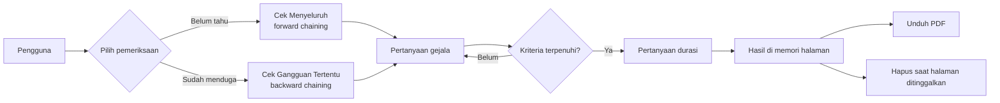

# Dokumentasi Sistem Pakar Gangguan Kecemasan, Depresi, Insomnia, dan Penyesuaian

Dokumentasi teknis dan operasional untuk aplikasi sistem pakar berbasis web ini. Isinya menjelaskan
cara aplikasi bekerja, mesin inferensi, basis pengetahuan, alur pengguna, perlakuan data, serta cara
mengembangkan dan men-deploy aplikasi.

Dokumentasi ini mencerminkan kode pada branch `main` per 29 Oktober 2026.

## Ringkasan sistem

| Aspek | Keterangan |
|---|---|
| Jenis aplikasi | SPA statis (satu halaman, tanpa server aplikasi) |
| Framework | Vue 3 (`<script setup>`, Composition API) |
| Build tool | Vite 8 + `@vitejs/plugin-vue` |
| Styling | Tailwind CSS 4 lewat `@tailwindcss/vite` |
| Routing | `vue-router` mode history, alamat bersih (`/artikel`) |
| PDF | `jspdf`, dimuat dinamis saat pengguna mengunduh |
| Ikon/font | Plus Jakarta Sans dari `@fontsource-variable/plus-jakarta-sans` (disimpan lokal) |
| Offline | PWA/service worker dari `vite-plugin-pwa` (Workbox) |
| Basis data | Tidak ada. Tidak ada login. Tidak ada API. |
| Basis pengetahuan | Tiga berkas JSON statis di `public/data/` |
| Metode inferensi | Forward chaining dan backward chaining |
| Jumlah gangguan | 11 gangguan yang diperiksa + `P0` (tidak menunjukkan kecenderungan) |
| Jumlah gejala | 69 entri: 67 pertanyaan langsung + 2 fakta antara |
| Jumlah sumber | 23 rujukan di `public/data/sumber.json` |
| Penyimpanan | Hanya progres konsultasi di IndexedDB; hasil tidak pernah disimpan |
| Target hosting | Hosting statis apa pun, GitHub Pages, atau nginx |

## Peta dokumentasi

| Dokumen | Isi |
|---|---|
| [arsitektur.md](./arsitektur.md) | Teknologi, urutan startup, peta modul, aliran data, routing, plugin build, pola UI |
| [mesin-inferensi.md](./mesin-inferensi.md) | Model aturan, status kriteria, urutan pertanyaan, forward/backward chaining, fakta antara, durasi, protokol krisis, API mesin |
| [algorithm.md](./algorithm.md) | Pseudocode `LANGKAH`, aturan pemilihan pertanyaan, trace contoh P2 dan P9, terminasi, determinisme, perbandingan dua metode |
| [basis-pengetahuan.md](./basis-pengetahuan.md) | Skema `gejala.json`, `penyakit.json`, `sumber.json`, tabel lengkap aturan dan gejala, validasi data, cara menambah gangguan |
| [alur-aplikasi.md](./alur-aplikasi.md) | Daftar rute, alur konsultasi, sinkronisasi tab, halaman hasil, isi PDF, protokol krisis dan pengguna remaja |
| [data-dan-privasi.md](./data-dan-privasi.md) | Apa yang disimpan dan tidak, IndexedDB, migrasi localStorage, service worker, perilaku offline, batasan privasi |
| [pengembangan-dan-deploy.md](./pengembangan-dan-deploy.md) | Persyaratan, perintah npm, struktur folder, build, GitHub Pages, nginx, pemeliharaan berkala, checklist QA |

Dokumen ringkas untuk pengguna dan kontributor juga tersedia di [README utama](../README.md).

## Alur besar aplikasi



## Mulai cepat

```bash
npm install
npm run dev      # development, biasanya http://localhost:5173
npm run build    # hasil statis di dist/
npm run preview  # mencoba hasil build
```

Untuk menjalankan sistem, tidak diperlukan PHP, MySQL, login, maupun konfigurasi server tambahan.
Rincian build dan publikasi ada di [pengembangan-dan-deploy.md](./pengembangan-dan-deploy.md).

## Catatan penting

Sistem ini adalah alat edukasi dan skrining mandiri, **bukan alat diagnosis**. Pertanyaan dan aturan
disusun dari DSM-5-TR, ICD-11, PPDGJ-III, dan pedoman klinis, tetapi belum divalidasi oleh psikolog
klinis atau psikiater. Rincian batasan ini juga ditampilkan kepada pengguna pada halaman `/tentang`.
