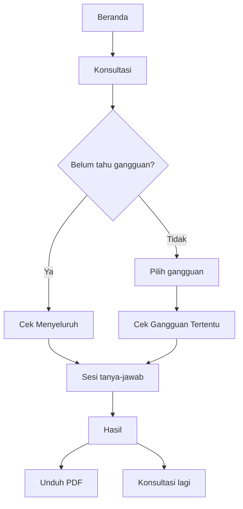

# Alur Aplikasi dan Antarmuka

## 1. Halaman dan rute

| Rute | Halaman | Isi |
|---|---|---|
| `/` | Beranda | Pengantar, tiga langkah, daftar 11 gangguan, catatan penting. |
| `/artikel` | Artikel | Rangkuman kecemasan/depresi, data WHO dan Indonesia, klasifikasi, penanganan, daftar gangguan. |
| `/konsultasi` | Konsultasi | Penjelasan singkat, kartu "lanjutkan" bila ada progres, pilihan Cek Menyeluruh / Cek Gangguan Tertentu. |
| `/cek-menyeluruh` | Cek Menyeluruh | `SesiKonsultasi` metode `forward`. |
| `/cek-gangguan?id=Pn` | Cek Gangguan Tertentu | Pemilih gangguan, kriteria opsional, `SesiKonsultasi` metode `backward`. |
| `/hasil` | Hasil | Hasil dari memori, unduh PDF, kriteria, jawaban. |
| `/sumber` | Sumber | Daftar pustaka bernomor dengan anchor per id. |
| `/tentang` | Tentang | Tujuan, batasan, privasi, kontak bantuan. |
| `/forward` | Redirect | Ke `/cek-menyeluruh`. |
| `/backward` | Redirect | Ke `/cek-gangguan`, query dipertahankan. |
| lain | Redirect | Ke `/`. |

Navigasi utama (header) hanya menampilkan Beranda, Artikel, Konsultasi, dan Sumber. Halaman Tentang
diakses lewat footer dan tautan di dalam teks.

## 2. Alur memilih pemeriksaan



`KonsultasiView.vue` membaca `ambilSesi("forward")` dan `ambilSesi("backward")` dari cache memori
yang diisi saat startup. Jika `urutan.length > 0`, muncul kartu "Lanjutkan ..." berisi jumlah
pertanyaan yang sudah dijawab. Untuk backward, target yang tersimpan dipakai pada tautan lanjutan.

`BackwardView.vue` memvalidasi `route.query.id` dengan `daftarPenyakit().includes(...)`. Jika tidak
valid, halaman hanya menampilkan pesan untuk memilih gangguan. Komponen `SesiKonsultasi` diberi
`key=target`, sehingga berpindah gangguan memulai komponen dan sesi baru.

## 3. Siklus sesi tanya-jawab

`SesiKonsultasi.vue` dipakai oleh kedua metode. Props: `metode` (`forward`/`backward`) dan `target`
(opsional).

### Inisialisasi

```js
const sesi = ref(lanjutkanAtauBaru(ambilSesi(props.metode)));
const siap = ref(sesi.value.urutan.length > 0);
```

- Sesi tersimpan dipakai hanya jika `target`-nya sama dengan props. Jika tidak, sesi baru dibuat.
- Petunjuk pengisian ditampilkan jika belum ada jawaban. Melanjutkan konsultasi melewati petunjuk.

### Urutan tampilan

1. **Petunjuk pengisian** (jika `!siap` dan bukan panel remaja):
   - enam butir petunjuk: jujur, fokus pada kondisi belakangan ini, baca teliti, boleh berhenti,
     isi dengan tenang, dan peringatan perangkat bersama;
   - pilihan usia: **"18 tahun ke atas, mulai"** atau **"Di bawah 18 tahun"**.
2. **Panel remaja** (jika memilih di bawah 18): pesan `ISI_REMAJA`, lalu tombol "Saya mengerti,
   mulai". Pesan ini juga muncul di hasil dan PDF.
3. **Panel krisis** (jika pertanyaan krisis dijawab *Ya*): kontak bantuan muncul sebelum pertanyaan
   berikutnya, dengan tombol "Saya mengerti, lanjutkan pertanyaan".
4. **Kartu pertanyaan**:
   - progress bar,
   - "Pertanyaan ke-N" dan label gejala atau "Durasi keluhan",
   - teks pertanyaan,
   - tombol **Ya** / **Tidak**, atau lima tombol pilihan durasi,
   - tombol **← Kembali**, **Mulai ulang**, **Hapus jawaban saya**,
   - pintasan keyboard (desktop): `Y`/`T`, dan `1`–`5` untuk durasi.
   Di layar kecil, teks pertanyaan baru digulirkan ke area pandang setelah menjawab, sehingga
   pengguna tidak hanya melihat tombol di bagian bawah kartu.
5. **Daftar jawaban** di bawah kartu, tertutup secara bawaan (`<details>`), agar tidak langsung
   terlihat orang lain di perangkat bersama.

### Aksi pengguna

| Aksi | Perilaku |
|---|---|
| Menjawab | `jawab(sesi, nilai)` mencatat gejala atau durasi dan menambah `urutan`. |
| Kembali | `batalkan(sesi)` menghapus jawaban terakhir, termasuk entri durasi. |
| Mulai ulang | Konfirmasi bila sudah ada jawaban; membuat sesi baru dengan urutan acak baru; usia dipertahankan. |
| Hapus jawaban saya | Konfirmasi; menghapus progres dari perangkat, mereset sesi, lalu pindah ke `/konsultasi`. |
| Menjawab *Ya* pada gejala krisis | Segera menampilkan `PanelKrisis`. |

Pintasan keyboard diabaikan saat panel petunjuk/remaja/krisis terbuka, saat tombol ditekan berulang,
atau saat ada modifier (Ctrl/Meta/Alt).

### Penyimpanan otomatis dan sinkronisasi

- `watch(sesi, simpanSesi)` menyimpan progres setiap kali sesi berubah.
- Sesi baru tanpa jawaban tidak disimpan; jika ada sesi lama untuk metode itu, sesi lama dihapus
  (memilih target backward lain menggantikan sesi sebelumnya).
- `visibilitychange` (tab kembali aktif), `pageshow`, dan pesan `BroadcastChannel("sispak")`
  memicu `sinkronkan()`. Sesi dibaca ulang dari IndexedDB, lalu dipakai bila targetnya cocok dan
  isinya berbeda.
- Jika konsultasi sudah dimulai di tab lain, layar petunjuk dilewati.

### Selesai

Watcher pada `langkah`:

```js
if (l.jenis !== "selesai") return;
buatHasil(sesi.value, l);
hapusSesi(props.metode);
router.push("/hasil");
```

Progres dihapus dari perangkat tepat saat hasil dibuat. Hasil hanya hidup di memori halaman
berikutnya.

## 4. Halaman hasil

`HasilView.vue` membaca `hasilTerakhir` (shallowRef). Jika kosong — misalnya halaman dimuat ulang
atau dibuka langsung — yang tampil adalah "Hasil tidak tersedia" dan ajakan memulai konsultasi.

Urutan blok:

1. **Panel krisis** (jika `entri.krisis`), di paling atas, sebelum hasil apa pun.
2. **Kepala hasil**:
   - eyebrow "Hasil pemeriksaan awal",
   - `judulHasil(entri)` yang menyebut kesesuaian gejala dengan kriteria, bukan "anda mengalami",
   - penjelasan bahwa hasil bukan diagnosis (atau penjelasan khusus backward/kriteria P0),
   - metode dan tanggal,
   - tombol **Unduh PDF** dan **Konsultasi lagi**.
3. **Pesan dukungan** (`PesanDukungan.vue`): disclaimer, tiga langkah lanjutan, pesan menenangkan.
4. **Blok remaja** (jika `entri.remaja`).
5. **Catatan privasi**: hasil tidak disimpan dan hilang saat halaman ditinggalkan.
6. **Blok durasi belum cukup** untuk setiap `belumCukup`, beserta `catatanDurasi`.
7. **Dua kolom**:
   - kiri: kartu tiap gangguan terdiagnosa (kode, kategori, deskripsi, `catatan`, penanganan,
     klasifikasi), tips kesehatan mental bila tidak ada gangguan, dan daftar jawaban;
   - kanan: kriteria tiap gangguan dan catatan penting tentang saran penanganan.

### Perlindungan hasil

- **Meninggalkan halaman** (`onBeforeRouteLeave`): jika belum mengunduh PDF, muncul dialog
  konfirmasi. Setelah dikonfirmasi, `hasilTerakhir` dihapus agar tidak bisa dibuka lagi oleh orang
  lain di perangkat yang sama. Jika PDF sudah diunduh, tidak ada konfirmasi.
- **Menutup tab / memuat ulang** (`beforeunload`): browser menampilkan dialog bawaannya sendiri,
  hanya jika hasil ada dan PDF belum diunduh. Situs tidak dapat mengganti tampilan dialog ini.
- **Cetak**: navigasi dan tombol disembunyikan dengan `print:hidden`, sehingga halaman hasil dapat
  dicetak tanpa kontrol antarmuka.

### Unduh PDF

`unduhPdf()` mengimpor `@/lib/pdf` secara dinamis, memanggil `unduhPdfHasil(entri)`, dan menandai
`sudahDiunduh` bila berhasil. PDF dibuat sebagai blob, lalu diunduh lewat anchor. URL blob
dikembalikan dan ditampilkan sebagai tautan cadangan **"buka PDF di sini"**, karena sebagian browser
ponsel memblokir unduhan otomatis. Di iPhone/iPad unduhan otomatis dilewati agar blob tidak membuka
tab yang sama dan menghilangkan halaman hasil; pengguna menekan tautan cadangan untuk membuka PDF.
Jika pembuatan gagal, muncul pesan "PDF gagal dibuat. Periksa koneksi internet anda lalu coba lagi."
Hasil tetap tampil.

## 5. Isi PDF

`src/lib/pdf.js` memakai jsPDF, A4, satuan mm, margin 18 mm, font Helvetica. Urutan:

1. Bilah warna di atas, label "HASIL KONSULTASI", nama sistem, jenis pemeriksaan, tanggal.
2. **Kotak krisis** (jika ada), didahulukan dari apa pun.
3. **Kotak disclaimer** (`ISI_DISCLAIMER`).
4. **Kotak remaja** (jika ada).
5. **Gambaran hasil**: judul netral, penjelasan sesuai hasil, dan catatan untuk gangguan yang
   durasinya belum cukup.
6. **Per gangguan terdiagnosa**: kode dan nama, kategori, deskripsi, `catatan`, daftar kriteria yang
   terpenuhi, durasi beserta jawaban pengguna, penanganan, klasifikasi, dan sumber.
7. **Tips kesehatan mental** (jika tidak ada gangguan).
8. **Jawaban anda** sebanyak N pertanyaan.
9. **Catatan penting**: dokumen rahasia, tidak disimpan sistem, saran bukan resep.
10. **Kotak langkah yang bisa diambil**: pesan menenangkan dan `LANGKAH_SELANJUTNYA`.
11. **Sumber**, diurutkan menurut nomor.
12. **Nomor halaman** di footer setiap halaman.

Nama berkas: `hasil-konsultasi-YYYY-MM-DD.pdf`, memakai tanggal lokal pengguna.

Karena font bawaan PDF hanya mendukung Latin dasar, teks dibersihkan lebih dulu: en/em dash menjadi
`-`, kutip melengkung menjadi kutip lurus, `·` menjadi `-`, `≥` menjadi `>=`, `→` menjadi `->`, dan
karakter di luar ASCII yang dapat dicetak dibuang.

Kotak berlatar warna menghitung tinggi isi lebih dulu agar tidak terpotong berpindah halaman.

## 6. Protokol krisis

Teks berada di `src/lib/pesanDukungan.js`, mengikuti pedoman WHO tentang pemberitaan/pesan
pencegahan bunuh diri: menenangkan, memberi harapan, tidak menyebut cara apa pun.

| Bagian | Perilaku |
|---|---|
| Pemicu | Gejala `"krisis": true` (`G58`) dijawab *Ya*. |
| Saat konsultasi | `PanelKrisis` muncul segera, sebelum pertanyaan berikutnya, dengan tombol lanjut. |
| Halaman hasil | Panel yang sama tampil di paling atas, tanpa tombol lanjut. |
| PDF | Kotak krisis ditempatkan sebelum disclaimer dan hasil. |
| Kontak | IGD / 112 / 119, Healing119 119 ext 8, chat WhatsApp lewat healing119.id, orang terpercaya, dan menjauhkan benda berbahaya. |
| Tanggal pemeriksaan kontak | `KONTAK_DIPERIKSA = "26 Oktober 2026"`, ditampilkan di panel. |

Pada Cek Menyeluruh, `G58` selalu ditanyakan sebelum kesimpulan walaupun P9 sudah gugur. Pada
Cek Gangguan Tertentu, hanya bila targetnya P9. Alasan dan mekanismenya ada di
[mesin-inferensi.md](./mesin-inferensi.md).

## 7. Pengguna di bawah 18 tahun

- Sebelum pertanyaan pertama, pengguna memilih usia.
- Pilihan "Di bawah 18 tahun" menampilkan `ISI_REMAJA` sebelum mulai: kriteria disusun untuk orang
  dewasa, sebaiknya diisi bersama orang tua/wali/guru BK, dan 119 ext 8 juga melayani remaja.
- Pilihan disimpan sebagai `usia: "remaja"` di sesi dan ikut tersimpan setelah jawaban pertama.
- Hasil menyimpan `remaja: true`; blok pesan remaja tampil di halaman hasil dan PDF.
- Jika sesi lama dilanjutkan, pilihan usia mengikuti sesi yang tersimpan. Sesi lama tanpa `usia`
  dianggap dewasa.

## 8. Pesan dan nada

- Judul hasil selalu menyebut **kesesuaian gejala dengan kriteria**, bukan vonis.
- Hasil tanpa kecenderungan memakai "tidak menunjukkan kecenderungan", bukan "tidak terdeteksi",
  disertai penjelasan bahwa skrining tidak menjamin bebas gangguan.
- Saran penanganan tidak menyebut nama obat; selalu merujuk ke resep dan pengawasan dokter.
- Disclaimer, pesan krisis, dan pesan remaja berada di satu berkas (`pesanDukungan.js`), dipakai
  halaman dan PDF agar kalimatnya identik.
- Dialog konfirmasi memakai komponen sendiri (`DialogKonfirmasi.vue`), bukan `alert`/`confirm`.

## 9. Aksesibilitas dan tampilan

- Kartu pertanyaan memakai `aria-live="polite"` agar perubahan pertanyaan diumumkan.
- Progress bar memakai `role="progressbar"` dengan `aria-valuenow/min/max`.
- Panel krisis memakai `role="alert"`.
- Dialog memakai `<dialog>` native dengan `aria-labelledby` dan `aria-describedby`; klik latar
  berarti batal, Esc juga batal.
- Fokus keyboard terlihat jelas (`:focus-visible`).
- Animasi dinonaktifkan saat pengguna memilih `prefers-reduced-motion`.
- Mode gelap mengikuti preferensi sistem.
- Navigasi dapat digulir horizontal di layar kecil; tombol dan kartu responsif.
