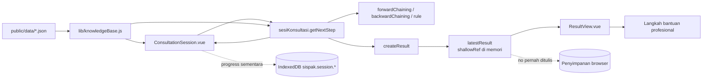

# Arsitektur Aplikasi

Keluaran diarahkan pada refleksi keluhan dan pencarian bantuan. Daftar kode internal tidak menjadi diagnosis. Hasil bersifat sementara dan tidak memiliki fitur ekspor.

## 1. Teknologi

| Lapisan | Implementasi |
|---|---|
| Entry HTML | `index.html` (sumber Vite) |
| Bootstrap | `src/main.js` |
| Framework | Vue 3.5 (`<script setup>`) |
| Router | `vue-router` mode `createWebHistory`, alamat bersih tanpa `#` |
| Build | Vite 8, plugin `@vitejs/plugin-vue`, `@tailwindcss/vite` |
| Styling | Tailwind CSS 4, token warna CSS di `src/assets/main.css` |
| Offline | `vite-plugin-pwa` (Workbox), registrasi di `src/lib/offline.js` |
| Penyimpanan | IndexedDB (`src/lib/storage.js`) |
| Komunikasi antar-tab | `BroadcastChannel("sispak")` |
| Data | Fetch JSON statis dari `<base>/data/*.json` |

Tidak ada backend, database, autentikasi, state manager eksternal, maupun permintaan ke layanan
pihak ketiga.

## 2. Urutan startup

`src/main.js` menjalankan urutan berikut:

```mermaid
flowchart TD
    A[index.html memuat src/main.js] --> B[enableOfflineCache]
    B --> C{initializeStorage}
    C -- reject --> D[Tampilkan instructions mengaktifkan penyimpanan browser]
    C -- berhasil --> E[loadKnowledgeBase]
    E -- reject --> F[Tampilkan galat basis pengetahuan]
    E -- berhasil --> G[loadProgress]
    G --> H[createApp(App).use(router).mount]
```

Detail:

1. **`enableOfflineCache()`** dipanggil lebih dulu. Fungsi ini mendaftarkan service worker bila
   browser mendukung. Kegagalan registrasi hanya dicatat di console; aplikasi tetap berjalan.
2. **`initializeStorage()`** membuka IndexedDB `sispak` dan melakukan uji tulis/hapus pada kunci
   `sispak.cek`. Jika IndexedDB tidak tersedia, diblokir, atau gagal ditulis, aplikasi **tidak
   dijalankan** dan pengguna diberi petunjuk per browser. Alasannya: tanpa penyimpanan, progres bisa
   hilang di tengah konsultasi.
3. **`loadKnowledgeBase()`** mengambil `data/conditions.json`, `data/symptoms.json`, dan
   `data/references.json` secara paralel dengan `fetch(..., { cache: "no-cache" })`, lalu memvalidasi dan
   menyusun indeks di memori. Jika gagal, muncul halaman galat dengan tombol muat ulang.
4. **`loadProgress()`** memigrasikan data localStorage lama, lalu membaca sesi `forward` dan `backward`
   dari IndexedDB.
5. Baru setelah semua siap, aplikasi Vue di-mount ke `#app`.

Basis pengetahuan sengaja dimuat **sebelum** mount agar komponen dapat mengakses objek global
`CONDITIONS`, `SYMPTOMS`, `REFERENCES`, dan `RULES` secara sinkron tanpa loading state di setiap halaman.

## 3. Peta modul

### Titik masuk dan kerangka

| Berkas | Tanggung jawab |
|---|---|
| `index.html` | Dokumen HTML sumber. Berisi skrip pengalih ke `dist/` bila dibuka langsung lewat web server; blok ini dibuang saat build. |
| `src/main.js` | Bootstrap, pemeriksaan penyimpanan, pemuatan data, penanganan galat fatal. |
| `src/App.vue` | Header/navigasi, banner versi baru, `<RouterView>`, footer, dialog konfirmasi global. |
| `src/router.js` | Daftar rute, judul dokumen per halaman, scroll ke anchor, redirect alamat lama. |
| `src/assets/main.css` | Token warna (mode terang/gelap), komponen Tailwind (`card`, `btn`, `pill`, dll.), aturan aksesibilitas. |

### Library inti

| Berkas | Tanggung jawab |
|---|---|
| `src/lib/basePath.js` | Menghitung `BASE_PATH` (alamat dasar aplikasi) dan mengubah URL hash lama `#/artikel` menjadi `/artikel`. |
| `src/lib/appName.js` | Nama panjang dan singkat sistem. |
| `src/lib/screeningHelp.js` | Konten bersama panduan konsultasi dan FAQ dalam dua bahasa. |
| `src/lib/knowledgeValidation.js` | Validasi menyeluruh sebelum aturan diaktifkan; tidak memangkas syarat. |
| `src/lib/knowledgeBase.js` | Pemuatan JSON, validasi data, indeks gejala/gangguan/aturan. |
| `src/lib/rules.js` | Fakta turunan, status kriteria, gejala relevan, pemeriksaan krisis. |
| `src/lib/forwardChaining.js` | Inferensi maju dan pemilihan pertanyaan penyaring. |
| `src/lib/backwardChaining.js` | Pembuktian tujuan dan pemilihan pertanyaan backward. |
| `src/lib/consultationSession.js` | Alur langkah berikutnya, pembuatan sesi, jawab, kembali. |
| `src/lib/consultationProgress.js` | Cache sesi, penyimpanan progres, sinkronisasi antar-tab. |
| `src/lib/consultationResult.js` | Hasil terakhir dalam memori Vue dan pembentukan hasil. |
| `src/lib/consultationDisplay.js` | Penamaan metode, format tanggal/durasi, judul hasil. |
| `src/lib/expertSystem.js` | Pintu masuk gabungan untuk fungsi publik modul. |
| `src/lib/storage.js` | Pembungkus IndexedDB, uji ketersediaan, migrasi dari localStorage. |
| `src/lib/offline.js` | Registrasi service worker, banner versi baru, pemanasan cache data. |
| `src/lib/supportMessages.js` | Satu sumber teks disclaimer, pesan krisis, pesan remaja, dan langkah lanjutan. |
| `src/lib/dialog.js` | State dialog konfirmasi berbasis Promise, pengganti `confirm()` browser. |

### Komponen

| Berkas | Tanggung jawab |
|---|---|
| `ConsultationSession.vue` | Seluruh alur tanya-jawab; dipakai metode forward dan backward. |
| `CrisisPanel.vue` | Kontak bantuan segera saat gejala krisis dijawab *Ya* dan di halaman hasil. |
| `SupportMessage.vue` | Disclaimer dan langkah lanjutan di halaman hasil. |
| `CriteriaList.vue` | Menampilkan kriteria sebuah gangguan beserta durasi minimal. |
| `ConditionCard.vue` | Kartu ringkas gangguan di beranda dan artikel. |
| `ImportantNote.vue` | Kotak peringatan yang dipakai ulang. |
| `ReferenceLink.vue` | Nomor rujukan `[n]` yang menaut ke `/references#<id>`. |
| `ConfirmationDialog.vue` | Elemen `<dialog>` native untuk konfirmasi. |

### Halaman

| Berkas | Rute |
|---|---|
| `HomeView.vue` | `/` |
| `ArticlesView.vue` | `/artikel` |
| `ConsultationView.vue` | `/konsultasi` |
| `ForwardView.vue` | `/cek-menyeluruh` |
| `BackwardView.vue` | `/cek-gangguan` |
| `ResultView.vue` | `/result` |
| `ReferencesView.vue` | `/references` |
| `AboutView.vue` | `/tentang` |

## 4. Aliran data



Poin penting:

- Data JSON menjadi **objek global yang bisa berubah** (`CONDITIONS`, `SYMPTOMS`, `REFERENCES`, `RULES`).
  Tidak ada state terpusat lain untuk basis pengetahuan.
- Sesi konsultasi adalah objek biasa yang dioper ke fungsi JavaScript biasa di `consultationSession.js`.
  `ConsultationSession.vue` menyimpan sesi di `ref` dan menulisnya ke IndexedDB lewat watcher.
- Hasil konsultasi hanya hidup di `shallowRef` `latestResult`. Tidak ada serialisasi ke
  penyimpanan.

## 5. Alamat dasar dan routing

### `BASE_PATH`

`src/lib/basePath.js`:

```js
export const BASE_PATH = import.meta.env.BASE_URL.startsWith("/")
    ? import.meta.env.BASE_URL
    : new URL("..", import.meta.url).pathname;
```

- Build dengan `BASE_PATH` (misalnya GitHub Pages) menghasilkan base absolut seperti
  `/name-repo/`.
- Build biasa memakai base relatif `./`. Karena JavaScript berada di `assets/`, alamat dasar
  dihitung naik satu folder agar fetch data tetap benar saat ditaruh di subfolder mana pun.
- URL lama berformat hash (`#/artikel`) diubah dengan `history.replaceState` saat modul dimuat,
  sebelum router membaca alamat.

### Rute

| Pola | Komponen | Menu aktif |
|---|---|---|
| `/` | Beranda | `home` |
| `/artikel` | Artikel | `artikel` |
| `/konsultasi` | Pilih metode | `konsultasi` |
| `/cek-menyeluruh` | Cek Menyeluruh | `konsultasi` |
| `/cek-gangguan?id=Pn` | Cek Gangguan Tertentu | `konsultasi` |
| `/result` | Hasil | `konsultasi` |
| `/references` | Daftar pustaka | `references` |
| `/tentang` | Tentang & batasan | `tentang` |
| `/forward` | Redirect ke `/cek-menyeluruh` | - |
| `/backward` | Redirect ke `/cek-gangguan` + query | - |
| lainnya | Redirect ke `/` | - |

Perilaku tambahan:

- `router.afterEach` mengatur `document.title` dari `meta.title`.
- `scrollBehavior` hanya menggulir ke anchor dengan format aman `#[\w-]+`, dengan offset 80 px
  untuk header lengket.
- Semua komponen halaman dimuat dinamis (*lazy load*).

## 6. Plugin build

`vite.config.js` menambahkan tiga plugin kustom/PWA:

1. **`removeSourceRedirect`** — membuang blok komentar `instructions-references` di `index.html` yang
   mengalihkan pengunjung ke `./dist/`. Blok ini hanya berguna saat folder proyek dibuka langsung
   lewat web server.
2. **`copyRoutePages`** — setelah build, menyalin `dist/index.html` menjadi `artikel.html`,
   `konsultasi.html`, `cek-menyeluruh.html`, `cek-gangguan.html`, `result.html`, `references.html`,
   `tentang.html`, `forward.html`, `backward.html`, dan `404.html`. Ini membuat GitHub Pages
   (yang tidak punya fallback SPA) melayani alamat bersih dengan status 200. Daftar `PAGE_ROUTES`
   harus disinkronkan dengan `src/router.js`.
3. **`VitePWA`** — menghasilkan service worker Workbox:
   - `registerType: "prompt"` dan `injectRegister: false` (registrasi manual di `offline.js`).
   - `manifest: false` (tidak ada manifest PWA; aplikasi tidak dipasang sebagai app).
   - Precache `**/*.{js,css,html,svg,woff2}` termasuk font dan katalog bahasa.
   - `navigateFallback: "index.html"` dengan pengecualian alamat ber-ekstensi (agar
     `data/conditions.json` tidak dialihkan ke HTML).
   - Runtime cache `sispak-data` dengan strategi **NetworkFirst**, timeout 5 detik, hanya
     status 200, untuk semua `*/data/*.json`.

`base` diambil dari `process.env.BASE_PATH` atau `"./"`. Alias `@` menunjuk ke `src/`.

## 7. Pola UI dan aksesibilitas

- Token warna di `main.css` otomatis mengikuti `prefers-color-scheme` (mode gelap).
- Komponen Tailwind yang dipakai berulang: `.container-page`, `.card`, `.btn`, `.btn-primary`,
  `.btn-ghost`, `.btn-text`, `.eyebrow`, `.pill`, `.empty`.
- Animasi masuk (`animate-enter`) dimatikan saat `prefers-reduced-motion: reduce`.
- Fokus keyboard memakai `:focus-visible` dengan outline tebal.
- Dialog konfirmasi memakai `<dialog>` native (`showModal`), sehingga fokus, tombol Esc, dan
  pembaca layar ditangani browser.
- Halaman hasil menyembunyikan tombol dan navigasi saat dicetak (`print:hidden`).
- Bahasa antarmuka seluruhnya Indonesia; teks hasil dirancang netral (lihat
  [application-flow.md](./application-flow.md)).

## 8. Penanganan kegagalan

| Kondisi | Perilaku |
|---|---|
| IndexedDB diblokir/tidak tersedia | Aplikasi tidak dijalankan; tampil petunjuk pengaturan Chrome/Edge, Firefox, Safari. |
| Salah satu JSON gagal dimuat | Halaman galat "Basis pengetahuan gagal dimuat" dengan tombol muat ulang. |
| Data JSON tidak konsisten | Peringatan di console browser; entri tidak valid dibuang, aplikasi tetap berjalan. |
| Service worker gagal didaftarkan | Peringatan di console; aplikasi tetap berjalan tanpa mode offline. |
| Progres gagal disimpan | Peringatan di console; konsultasi tetap berjalan di memori. |

## 9. Batasan arsitektur

- Tidak ada test otomatis, lint, atau pemeriksaan tipe. Validasi masih manual dan lewat peringatan
  console.
- Basis pengetahuan adalah objek global yang dapat berubah; tidak ada immutability atau skema
  runtime formal.
- Hasil konsultasi sengaja tidak dapat di-refresh. Reload halaman hasil akan menghapusnya.
- Tidak ada server, sehingga tidak ada sinkronisasi antarperangkat, riwayat, atau akun.
- Perubahan data JSON di hosting langsung terlihat saat online karena fetch `no-cache` dan strategi
  NetworkFirst, tetapi pengguna yang sudah membuka sesi akan memakai sesi berjalan sampai selesai.
