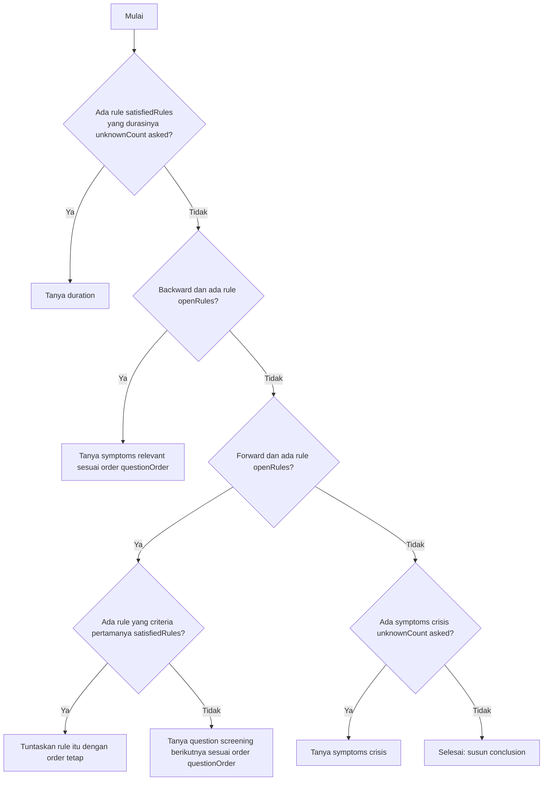

# Mesin Inferensi

Alur inferensi berada di `src/lib/consultationSession.js`, dengan algoritma di `forwardChaining.js` dan
`backwardChaining.js`, serta pemeriksaan fakta/kriteria di `rules.js`. Fungsi inferensi membaca
basis pengetahuan yang telah dimuat dan tidak bergantung pada Vue. Fungsi langkah/jawaban menerima
objek sesi dan mengembalikan langkah atau sesi baru. Efek samping
(penyimpanan dan navigasi) ditangani di komponen.

Untuk pseudocode lengkap, aturan pemilihan pertanyaan, trace contoh P2/P9, serta pembahasan
terminasi dan determinisme, lihat [algorithm.md](./algorithm.md).

Implementasi memakai **working memory eksplisit**: `deriveFacts()` menghitung closure fakta turunan
sampai stabil, `runForwardInference()` melakukan pencocokan dan firing aturan sampai fixed point, sedangkan
backward chaining memakai pembuktian rekursif tujuan → aturan → kriteria → subgoal gejala.

Kode pada `conditions` dan `insufficientDuration` tetap dipakai mesin aturan, tetapi disajikan hanya sebagai topik untuk dibicarakan dengan profesional. Label aturan terpenuhi bukan diagnosis pengguna. Hasil tanpa pola tidak menyingkirkan gangguan, dan durasi kurang tidak menjadi alasan menunda bantuan. Tidak ada fitur ekspor hasil.

## 1. Model pengetahuan

Setiap gangguan diperlakukan sebagai **aturan produksi**:

```
IF   criteria 1 satisfiedRules
AND  criteria 2 satisfiedRules
...
THEN conditions Pn
```

Satu kriteria adalah kumpulan gejala dengan batas minimal:

```json
{ "symptoms": ["G19", "G20", "G21", "G22", "G23", "G68"], "minimum": 3 }
```

Kriteria dianggap terpenuhi jika jumlah gejala yang dijawab *Ya* mencapai `minimum`. Jika `minimum`
tidak ditulis, semua gejala pada kriteria itu wajib *Ya*.

Setelah semua kriteria sebuah gangguan terpenuhi, sistem menanyakan **durasi** keluhan. Durasi
menjadi penentu akhir: jika jawaban durasi mencapai `minimumDuration`, gangguan disimpulkan; jika
belum, gangguan masuk daftar `insufficientDuration`.

## 2. Bentuk sesi

```js
{
  method: "forward",          // "forward" | "backward"
  target: null,               // code conditions untuk backward, null untuk forward
  facts: {                    // answers symptoms; hanya symptoms langsung (bukan facts antara)
    G02: true, G18: true, G19: true, G20: true, G21: true, G99: true
  },
  deferredAnswers: {},        // kode pertanyaan -> "unsure" | "skipped"; bukan fakta boolean
  duration: { P2: 180 },        // code conditions -> days (value DURATION_OPTIONS)
  order: [                   // order answers untuk tombol previous dan list answers
    "G02", "G18", "G19", "G20", "G21", "G99", "duration:P2"
  ],
  questionOrder: ["G07", "G01", ...],  // order questionOrder yang dibuat sekali per session
  ageGroup: "adult"              // "adult" | "minor"; opsional untuk session legacy
}
```

Catatan:

- `order` hanya berisi kode gejala langsung atau `duration:<code>`. Fakta antara tidak pernah masuk.
- `questionOrder` untuk forward berisi urutan acak **pertanyaan penyaring**; untuk backward berisi urutan
  acak **seluruh gejala hipotesis**, dengan gejala bertanda `askLast` dipindah ke belakang.
- Urutan acak dibuat sekali saat `createSession()` dan disimpan, sehingga tetap sama setelah reload.
  Pengacakan memakai `crypto.getRandomValues` bila tersedia, dengan fallback `Math.random`, dan
  algoritme Fisher–Yates.

## 3. Fakta antara

Gejala bertanda `"sources"` tidak ditanyakan. Nilainya disimpulkan dari gejala asal:

```js
function value(code, facts, visited = new Set()) {
    const g = SYMPTOMS[code];
    if (!g || !g.sources) return facts[code];
    if (visited.has(code)) return undefined;

    const nextVisited = new Set(visited).add(code);
    const references = g.sources.map((k) => value(k, facts, nextVisited));
    if (references.some((v) => v === true)) return true;
    if (references.every((v) => v === false)) return false;
    return undefined;
}
```

- *Ya* jika salah satu gejala asal *Ya*.
- *Tidak* jika semua gejala asal *Tidak*.
- Belum diketahui jika belum ada yang *Ya* dan masih ada yang belum dijawab.

Yang ditanyakan untuk fakta antara adalah gejala asalnya (`getUnansweredSymptoms`). Fakta antara dihitung
sebagai **satu gejala** pada batas `minimum`.

`deriveFacts(facts)` menghitung penutupan (closure) semua fakta turunan sampai tidak ada nilai baru.
Hasilnya menjadi working memory untuk forward chaining. Closure ini **tidak ditulis ke sesi**;
sesi tetap hanya berisi jawaban langsung pengguna.

Fakta antara saat ini:

| Fakta | Arti | Disimpulkan dari | Dipakai |
|---|---|---|---|
| `G68` | Tidur dalam periode kekhawatiran | `G109`, `G24` | `P2` |
| `G69` | Tidur dalam periode suasana hati | `G90`, `G53` | `P9` |

Gejala asal wajib berupa pertanyaan langsung. Fakta antara bertingkat ditolak saat validasi data.

## 4. Status kriteria dan aturan

```js
// yes     = symptoms pada criteria yang inferredCodes dijawab Ya
// unknownCount  = symptoms pada criteria yang unknownCount diketahui
if (yes >= minimum)                 return "satisfied";
if (yes + unknownCount < minimum)          return "rejected";     // no mungkin lagi satisfiedRules
return "open";
```

Status aturan:

- `rejected` jika ada minimal satu kriteria `rejected`.
- `satisfied` jika semua kriteria `satisfied`.
- `open` selain itu.

Karena perhitungan hanya menghitung jawaban *Ya* dan memperlakukan yang belum dijawab sebagai
"mungkin *Ya*", aturan menjadi gugur secepat mungkin. Inilah yang membuat sistem dapat melewati
pertanyaan yang tidak lagi relevan tanpa mengubah hasil akhir.

`getRelevantSymptoms(rule)` mengembalikan gejala yang belum dijawab pada kriteria yang masih `open`
saja. Gejala pada kriteria yang sudah `satisfied` atau `rejected` tidak ditanyakan lagi. Kode yang dipilih Kurang yakin/Lewati disaring dari pertanyaan, tetapi nilai faktanya tetap belum diketahui.

Untuk forward chaining, `runForwardInference(facts, duration, rule)` memakai working memory hasil
`deriveFacts`, mencocokkan semua aturan yang kandidat, dan menambahkan penyakit yang kriterianya
terpenuhi serta durasinya cukup. Proses diulang sampai tidak ada fakta baru (fixed point). Penyakit
yang sudah disimpulkan tidak di-fire ulang; aturan alternatif untuk penyakit yang sama tidak perlu
ditanya durasinya lagi.

## 5. Urutan langkah berikutnya

`getNextStep(session)` menentukan satu langkah dengan prioritas berikut:



Detail prioritas:

1. **Durasi lebih dulu.** Aturan yang sudah `satisfied`, memiliki `minimumDuration > 0`, durasinya
   belum dijawab, dan penyakitnya belum disimpulkan oleh aturan lain. Aturan pertama menurut urutan
   `RULES` dipilih. Durasi tidak menunggu aturan lain selesai.
2. **Backward chaining.** `proveGoal(target)` mencoba semua aturan yang menyimpulkan target.
   Setiap aturan dibuktikan lewat kriteria-kriterianya; setiap kriteria membuktikan gejalanya, dan
   fakta antara dibuktikan sebagai subgoal OR dari gejala sumbernya. Pertanyaan diambil dari subgoal
   yang belum pasti menurut `session.questionOrder`. Jika satu aturan gugur, aturan alternatif dicoba; jika ada
   aturan yang berhasil, tujuan terbukti.
3. **Forward chaining.**
   - Jika ada aturan `open` yang **kriteria pertamanya sudah terpenuhi** ("pertanyaan penyaring"
     dijawab *Ya*), aturan itu dituntaskan lebih dulu. Jika ada beberapa, dipilih yang pertanyaan
     penyaringnya dijawab paling awal (`getActivationIndex`). Gejala lanjutannya ditanyakan menurut urutan
     tetap pada definisi kriteria, bukan acak, agar alur tetap runtut.
   - Jika tidak ada, tanyakan pertanyaan penyaring berikutnya menurut `session.questionOrder`. Pertanyaan
     penyaring adalah gejala pada kriteria pertama setiap aturan.
4. **Protokol krisis.** Gejala bertanda `crisis` yang belum ditanyakan selalu ditanyakan sebelum
   kesimpulan, walaupun status aturannya tidak lagi membutuhkan jawaban itu.
5. **Selesai.** Hitung kesimpulan.

Nilai `remaining` yang dikembalikan dipakai untuk progress bar:

```js
new Set([...symptoms relevant semua rule openRules, ...symptoms crisis]).size
  + count duration yang tertunda
  + count rule openRules
```

Ini adalah **perkiraan**, bukan jumlah pertanyaan tersisa yang pasti, karena aturan bisa gugur dan
mengurangi jumlah pertanyaan di tengah jalan. Karena itu progress bar dapat melompat maju, bukan
menunjukkan jumlah pertanyaan yang tersisa secara tepat.

## 6. Forward chaining (Cek Menyeluruh)

Karakteristik:

- Kandidat aturan = **semua** aturan.
- Working memory dimulai dari jawaban gejala, lalu `deriveFacts()` menambahkan fakta turunan seperti
  `G68`/`G69`. `runForwardInference()` mencocokkan semua aturan dan menambahkan penyakit yang kriterianya
  terpenuhi serta durasinya cukup, lalu mengulang sampai tidak ada fakta baru.
- Dimulai dari pertanyaan penyaring yang diacak. Tujuannya menemukan gangguan tanpa pengguna harus
  tahu nama gangguannya.
- Begitu satu penyaring dijawab *Ya*, sistem menuntaskan aturan tersebut sampai semua kriterianya
  terpenuhi atau salah satu kriteria gugur, lalu bertanya durasi bila perlu.
- Setelah aturan itu selesai/gugur, sistem kembali ke pertanyaan penyaring berikutnya.
- Bisa menyimpulkan lebih dari satu gangguan. Tidak ada conflict resolution karena beberapa
  gangguan memang dapat muncul bersamaan (multi-label), bukan saling meniadakan.
- Gejala yang sudah tidak dapat mengubah status aturan mana pun tidak ditanyakan.

Contoh untuk `P2` Gangguan Kecemasan Menyeluruh:

1. `G02` (khawatir berlebihan) dijawab *Ya* → P2 difokuskan.
2. `G18` (sulit mengendalikan khawatir) ditanyakan.
3. `G19`–`G23` dan `G68` ditanyakan sampai minimal 3 dijawab *Ya*.
4. `G99` (mengganggu kehidupan sehari-hari) ditanyakan.
5. Semua kriteria terpenuhi → `runForwardInference` menandai P2 terpenuhi; sistem menanyakan durasi P2.
6. Jawaban ≥ 180 hari → P2 di-fire ke working memory dan disimpulkan. Jawaban < 180 hari → P2 masuk
   `insufficientDuration`.

## 7. Backward chaining (Cek Gangguan Tertentu)

Karakteristik:

- Kandidat aturan = hanya aturan dengan `conditions === session.target`.
- Pengguna memilih hipotesis lebih dulu.
- `proveGoal(target)` mencoba setiap aturan yang menyimpulkan target. Jika satu aturan gugur,
  aturan alternatif dicoba; jika salah satu berhasil, tujuan terbukti.
- `proveRule` membuktikan semua kriteria (AND). `proveCriterion` membuktikan ambang minimal
  gejala. `proveSymptom` membuktikan gejala langsung sebagai daun, atau fakta antara sebagai
  subgoal OR yang sumbernya dibuktikan rekursif.
- Pertanyaan diambil dari subgoal yang belum pasti, menurut urutan acak sesi. Gejala bertanda
  `"askLast": true` (misalnya G99 untuk P2 dan G106 untuk P9) selalu berada di akhir urutan acak.
- Jika satu kriteria tidak mungkin terpenuhi, aturan langsung `rejected` dan tidak ada pertanyaan
  lanjutan untuk aturan itu. Sistem selesai dengan hasil "belum sesuai kriteria".
- Jika semua kriteria terpenuhi, durasi ditanyakan seperti pada forward.

Contoh untuk `P9` Gangguan Depresi Mayor:

- Kriteria 1: minimal 1 dari `G50`/`G51`.
- Kriteria 2: minimal 5 dari 9 gejala (`G50`, `G51`, `G52`, `G69`, `G54`–`G58`).
- Kriteria 3: `G106`.
- `G69` dibuktikan sebagai subgoal OR dari `G90` atau `G53`.
- Bila lima jawaban *Tidak* membuat kriteria 2 mustahil, aturan gugur dan pertanyaan berhenti.
- Bila semua terpenuhi, durasi ≥ 14 hari menyimpulkan P9.

## 8. Durasi

Pilihan durasi (batas bawah tiap pilihan):

| Label | Nilai `days` |
|---|---|
| Kurang dari 2 minggu | 0 |
| 2 minggu sampai 1 bulan | 14 |
| 1 sampai 3 bulan | 30 |
| 3 sampai 6 bulan | 90 |
| 6 bulan atau lebih | 180 |

Aturan kelulusan: `minimumDuration === 0` selalu cukup; selain itu `answers >= minimumDuration`.
Konsekuensinya, pilihan "2 minggu sampai 1 bulan" bernilai **14 hari** dan **tidak** memenuhi
`minimumDuration` 30 hari. Ini disengaja: nilai pilihan adalah batas bawah, sehingga keputusan dibuat
konservatif.

| `minimumDuration` | Pilihan minimum yang lolos |
|---|---|
| 14 | 2 minggu sampai 1 bulan |
| 30 | 1 sampai 3 bulan |
| 90 | 3 sampai 6 bulan |
| 180 | 6 bulan atau lebih |

`minimumDuration` 0 (P1, P4, P11, P12; konteks waktu P1 ada pada G17) tidak menampilkan pertanyaan durasi.

## 9. Protokol krisis

Gejala dengan `"crisis": true` (saat ini `G58`, pikiran tentang kematian atau menyakiti diri)
diperlakukan khusus:

- Daftar kandidat krisis diambil dari **semua aturan kandidat**, bukan hanya aturan yang masih
  terbuka. Pada Cek Menyeluruh, `G58` selalu ditanyakan sebelum kesimpulan, walaupun P9 sudah gugur.
  Pada Cek Gangguan Tertentu, hanya jika targetnya memuat gejala tersebut (P9).
- Pertanyaan krisis berada di prioritas 4, sehingga ditanyakan setelah aturan terbuka dan durasi
  tertunda selesai.
- Jika dijawab *Ya*, `ConsultationSession.vue` langsung menampilkan `CrisisPanel` sebelum pertanyaan
  berikutnya.
- `getCrisisAnswers(facts)` mengembalikan kode gejala krisis yang dijawab *Ya*. Hasil menyimpan
  `crisis: true`, dan panel krisis ditempatkan paling atas di halaman hasil.

## 10. Topik penyesuaian dan diagnosis banding

Tidak ada aturan aktif yang memakai `residual`. P11 dapat muncul sebagai topik percakapan bersama topik lain. Dukungan generik field tersebut masih ada pada engine untuk kompatibilitas struktur, tetapi tidak mewakili penilaian diagnosis banding. Profesional menentukan apakah keluhan lebih tepat dijelaskan oleh kondisi lain.

## 11. Kesimpulan dan determinisme

```js
{
  kind: "complete",
  conditions: ["P2"],          // topik percakapan, bukan diagnosis
  insufficientDuration: ["P9"],        // criteria satisfiedRules tetapi duration unknownCount mencapai limit
  duration: { P2: 180 }
}
```

Kesimpulan **selalu sama untuk jawaban yang sama**, apa pun urutan pertanyaannya, karena:

1. Status kriteria hanya bertambah *Ya*; jawaban *Tidak* tidak membatalkan *Ya* sebelumnya.
2. Aturan baru gugur jika bahkan seluruh jawaban *Ya* yang tersisa tidak cukup.
3. Pertanyaan hanya diajukan jika jawabannya masih dapat mengubah status aturan, kecuali gejala
   krisis yang memang selalu ditanyakan.
4. Durasi ditanyakan untuk setiap aturan yang terpenuhi dan penyakitnya belum disimpulkan, tanpa
   bergantung pada urutan.

Basis pengetahuan dimuat sebelum mount dan tetap di memori tab. Perubahan makna pertanyaan/aturan harus menaikkan `KNOWLEDGE_VERSION`. Progres versi lama tidak dilanjutkan; kunci penyimpanan per versi memisahkan tab lama. Deploy kode, tiga JSON, dan terjemahan bersama.

## 12. Objek hasil

`createResult(session, conclusion)` menyimpan ke `latestResult` (sebuah `shallowRef`):

```js
{
  timestamp: Date.now(),
  method: "forward",
  target: null,
  conditions: ["P2"],
  insufficientDuration: ["P9"],
  duration: { P2: 180, P9: 14 },
  crisis: false,
  isMinor: false,
  answers: [
    { code: "G02", question: "...", answers: "Ya", yes: true },
    { code: "duration:P2", question: "Sudah berapa legacy ...", answers: "6 bulan atau lebih", yes: null }
  ]
}
```

Objek ini tidak pernah diserialisasi ke penyimpanan. Lihat [data-and-privacy.md](./data-and-privacy.md).

## 13. API mesin

| Fungsi | Kegunaan |
|---|---|
| `loadKnowledgeBase()` | Memuat, memvalidasi, dan mengindeks tiga JSON. |
| `isValidCondition(code)` | Memeriksa kode penyakit untuk query string. |
| `listConditions()` | Daftar kode yang punya aturan (tanpa `P0`). |
| `createSession(method, target)` | Membuat sesi baru beserta urutan acak. |
| `deriveFacts(facts)` | Menghitung closure fakta turunan (`sources`) sampai stabil. |
| `runForwardInference(facts, duration, rule)` | Forward chaining: working memory + firing aturan sampai fixed point. |
| `getNextStep(session)` | Langkah berikutnya: `symptom`, `duration`, atau `complete`. |
| `answerQuestion(session, value)` | Mencatat jawaban dan mengembalikan sesi baru. |
| `undoAnswer(session)` | Menghapus jawaban terakhir (gejala atau durasi). |
| `listAnswers(session)` | Jawaban siap tampil untuk UI. |
| `getDurationQuestion(code)` | Kalimat pertanyaan durasi. |
| `loadProgress()` | Migrasi data lama dan memuat sesi tersimpan. |
| `reloadSession(method)` | Membaca ulang sesi dari IndexedDB. |
| `getSavedSession(method)` | Mengambil sesi dari cache memori. |
| `areSessionsEqual(a, b)` | Membandingkan sesi untuk sinkronisasi UI. |
| `saveSession(session)` / `deleteSession(method)` | Menulis/menghapus progres. |
| `onSessionChange(fn)` | Berlangganan perubahan sesi dari tab lain. |
| `createResult(session, conclusion)` | Menyusun objek hasil di memori. |
| `getMethodName()`, `getMethodRoute()` | Nama awam dan URL metode. |
| `getResultTitle(entry)` | Judul hasil yang netral (bukan "anda mengalami ..."). |
| `formatDate()`, `formatDuration()` | Format tampilan tanggal dan durasi. |

## 14. Keterbatasan mesin

- Penalaran hanya berbasis hitungan *Ya*; tidak ada bobot, certainty factor, atau penalaran negatif.
- Basis aturan saat ini **satu tingkat**: premis aturan berupa gejala/fakta antara, belum ada aturan
  yang memakai penyakit lain sebagai premis. Mesin sudah memiliki working memory dan fixed point,
  tetapi data belum membutuhkan rantai penyakit bertingkat.
- Tidak ada penjelasan rantai inferensi terperinci untuk pengguna; halaman hasil menampilkan
  topik percakapan dan bantuan, bukan kriteria diagnosis atau jejak aturan.
- `remaining` hanyalah perkiraan untuk progress bar.
- Tes perilaku tersedia di `tests/`, termasuk kasus regresi hasil audit.
- Data dan aturan belum divalidasi secara klinis.

## 15. Jawaban belum pasti dan hasil parsial

Lihat [screening-help.md](./screening-help.md) untuk alur terbaru. `getNextStep()` tidak mengulangi kode dalam `deferredAnswers`. Sesi dapat selesai dengan aturan yang tetap `open`; kode terkait masuk `incompleteConditions`, bukan kesimpulan atau penolakan. Durasi belum diketahui tidak masuk `insufficientDuration`. Pertanyaan keselamatan tetap ditawarkan, tetapi pengguna dapat menundanya dan menerima penjelasan keterbatasan beserta kontak bantuan.
